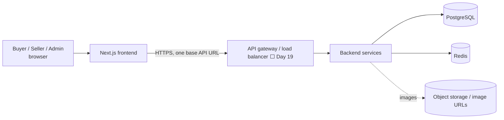
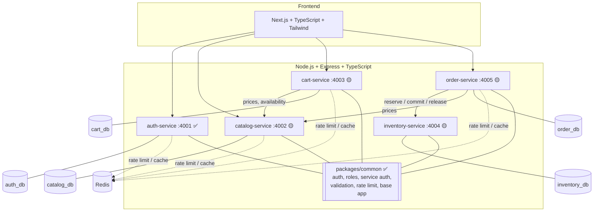
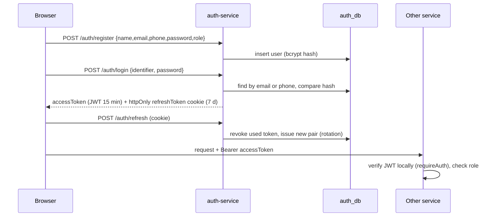
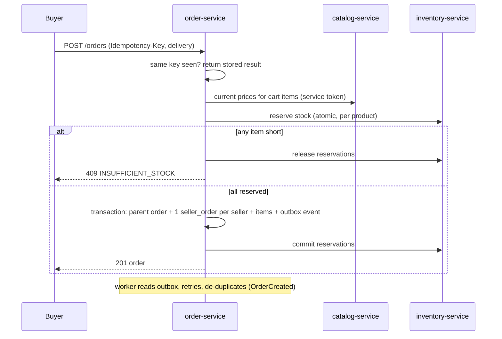

# Architecture Report: Multi-Vendor Marketplace

Status as of backend Day 5. **✅ built and tested · 🟡 designed, not built · ⬜ planned later.**

## 1. Purpose and scope
A Daraz-style marketplace: many sellers list products, a buyer checks out once with items from several sellers, and the system creates one parent order plus one order per seller. Built by two people in 30 days (frontend: MdAbdurRahmanRifat, backend: S M Shible Sadik) following `microservices_marketplace_30_day_plan_multi_server`. It is a deployable MVP, not a million-user system: scalability is designed in (stateless services, shared cache, load balancing) and then measured, not assumed.

## 2. System context


## 3. Services and data ownership

| Service | Owns | Key rules |
|---|---|---|
| auth | users, refresh tokens, roles | passwords hashed (bcrypt 12), rotating refresh tokens |
| catalog | categories, products, images, seller profiles | only ACTIVE + approved products are public; sellers touch only their own |
| cart | carts, cart items | never stores prices; reads them from catalog |
| inventory | stock, reservations | **database is the source of truth**; atomic conditional update prevents overselling; Redis is never the ledger |
| order | parent orders, seller orders, items, payments (COD), outbox | idempotency key; server-side price recalculation; price/name snapshot at purchase |

One database per service, no cross-database foreign keys; services refer to each other by id and talk over HTTP. Admin functions live in a protected module of catalog/order at first; a notification worker comes after the outbox.

## 4. Main flows
### 4.1 Authentication ✅

### 4.2 Checkout and multi-vendor split 🟡 (Days 11-16)

Inventory reserve is one statement: `UPDATE stock SET reserved = reserved + q WHERE product_id = ? AND on_hand - reserved >= q`; if zero rows change, stock was insufficient. Two buyers racing for the last unit cannot both succeed.

## 5. Security design ✅ (details in `security.md`)
Local JWT verification in every service; role + ownership checks; separate short-lived service-to-service tokens; Zod validation; secrets only from env (min 32 chars, fail fast); helmet, CORS allowlist, body limits, no stack traces; Redis rate limiting with in-memory fallback; correlation ids in logs. Frontend is never the security boundary.

## 6. Scalability and reliability design
| Requirement | Design | Status |
|---|---|---|
| ≥2 stateless instances behind a load balancer | no local state/files; config from env; `/health` + `/ready`; graceful SIGTERM shutdown | services ✅, LB ⬜ Day 19/26 |
| Autoscaling | min/max instances, scale on CPU or request rate, readiness gating, scale-in drain | ⬜ Day 26 |
| Shared state | Redis for rate limits (✅) and catalog cache (⬜ Day 17); sessions via DB-backed refresh tokens | partial |
| DB protection | connection pool limits per instance, indexes, EXPLAIN ANALYZE, no retry storms | ⬜ Days 24-25 |
| Async work | transactional outbox + retrying worker before any Kafka | ⬜ Day 16 |
| Failure handling | timeouts, bounded retries only for idempotent calls, compensating release of stock | ⬜ Days 13, 19 |
| Backups | scheduled backups + restore drill | ⬜ Day 28 |

Honest limit: autoscaling does not remove bottlenecks in Postgres, Redis or network; the claim "handles N users" will only be made with load-test evidence (k6, Day 24).

## 7. Repository and tooling ✅
```
packages/common/   shared library (built to dist, imported as @marketplace/common)
services/*         one folder per service (own package.json, tests, env example, Prisma where needed)
infra/             postgres init (DB per service), shared Dockerfile
docs/              plan, architecture, ERD, OpenAPI, daily log
frontend/          Next.js app (partner)
docker-compose.yml postgres, redis, all services
```
npm workspaces at the root; `npm install && npm test` covers everything. Tests: 15 (common) + 13 (auth) + 4 (placeholder health) pass locally, including real Postgres and Redis. Docker build/compose are written but have not been executed yet (Docker was not running).

## 8. Frontend status and integration
The frontend is at its Day 8: login/register, navbar role reactivity, home + product listing, product details, search/filter/sort with URL params. It currently uses mock data (`data/products.ts`) and a fake `localStorage` token. The real auth API is already compatible with its forms (verified in a local run: register → login by phone → account page via refresh + `/me`). Integration tasks: swap mock auth for `fetch` with `credentials: "include"`, keep the access token in memory, then replace `MOCK_PRODUCTS` with the catalog API (Day 6-7 backend) and map `title/image/seller` to the API's names. Prices: frontend uses decimals (199.99); the API will use integer minor units (19999) - needs a single conversion helper.

## 9. Key decisions
| Decision | Why |
|---|---|
| 5 services, not one per feature | two people, 30 days: fewer moving parts, still clear ownership |
| DB per service | enforces ownership, prevents shared-table coupling |
| Postgres + Prisma | constraints, transactions, row-level atomic updates for stock |
| JWT access + rotating refresh cookie | stateless verification in every service, revocable sessions |
| Redis for cache/limits only | not a source of truth; safe to lose |
| Outbox before a message broker | reliable events without operating Kafka |
| COD only | scope control; payment state model still designed |
| Money as integer minor units | no float rounding errors |

## 10. Risks
- Frontend/backend drift: mitigate with OpenAPI contracts and daily integration.
- Branch divergence: frontend work sits on feature branches, not `main`: merge often.
- Time: cut optional features (analytics, coupons), never authorization, inventory correctness or critical tests.
- Docker/deployment untested so far: validate early (Day 6-7), not on Day 23.

## 11. Roadmap (backend)
Day 6-7 catalog + tests/indexes/seed → 8 search → 9 seller approval + admin moderation → 10 cart → 11-12 checkout contract + inventory → 13-15 orders, COD, seller orders → 16 outbox → 17-18 cache + Redis limits (hardening) → 19 gateway → 20-22 admin + security/integration tests → 23-26 observability, load test, deployment → 27-30 resilience tests, backup, docs, demo.
