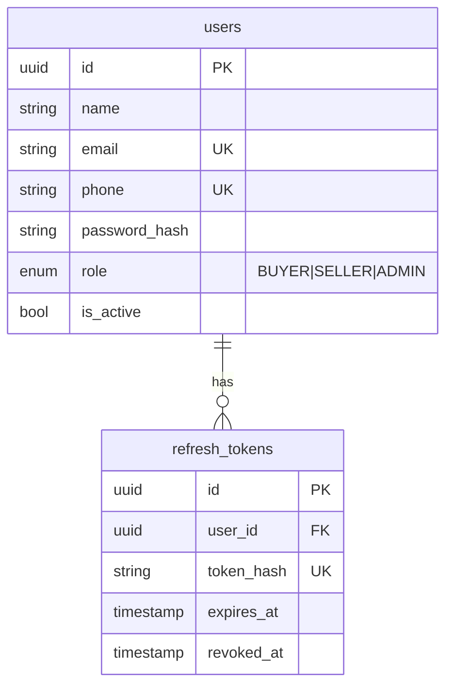
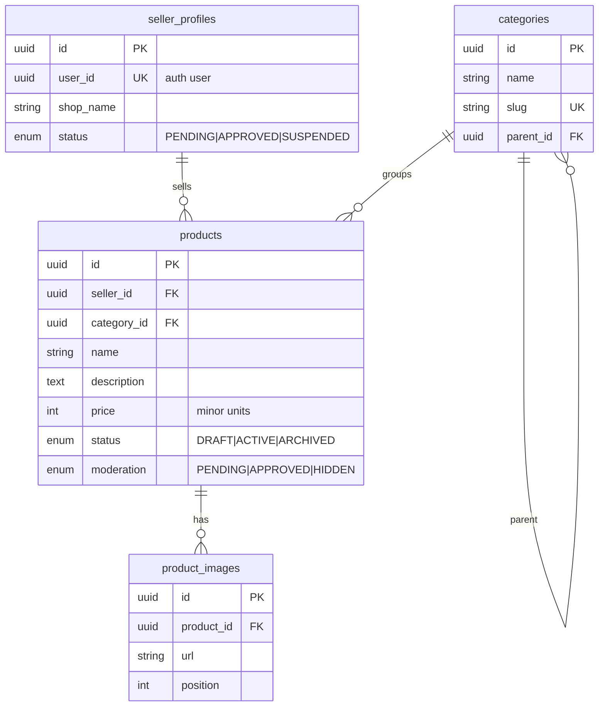
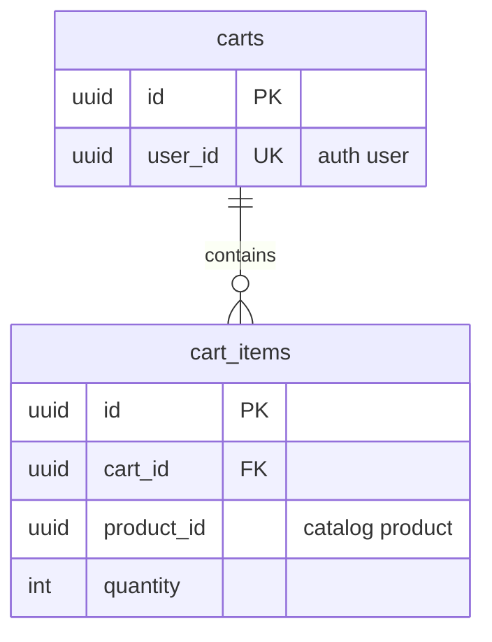
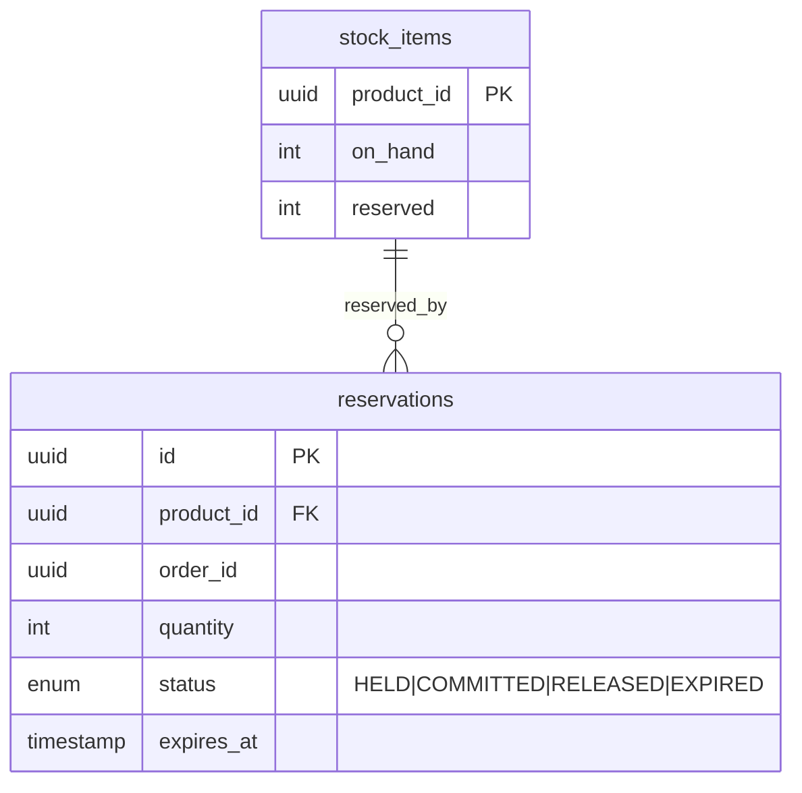
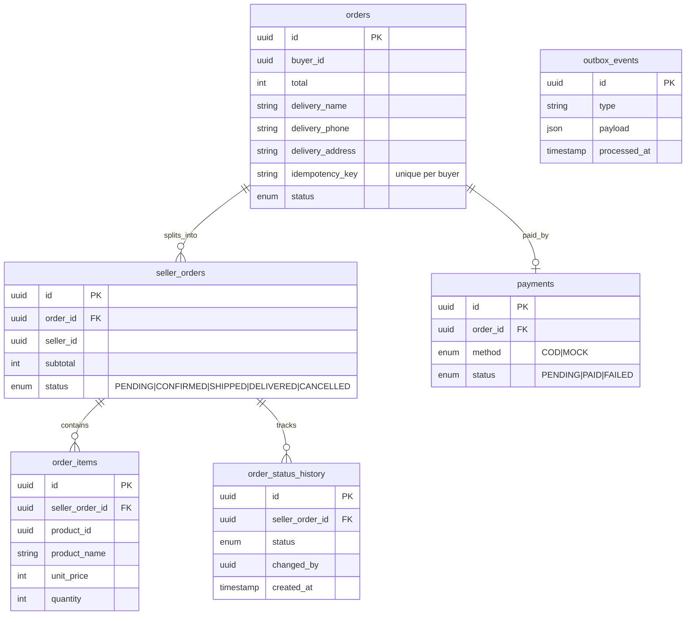

# ERD per service

Each service has its own database. Cross-service references are plain ids (no foreign keys across databases).

## auth_db (implemented)

## catalog_db

Indexes: products(category_id), products(seller_id), products(name) / full-text. Display stock is read from inventory-service.

## cart_db

Unique (cart_id, product_id). Prices are never stored in the cart; read from catalog at view/checkout.

## inventory_db

Atomic reserve: `UPDATE stock_items SET reserved = reserved + :q WHERE product_id = :id AND on_hand - reserved >= :q`.

## order_db

