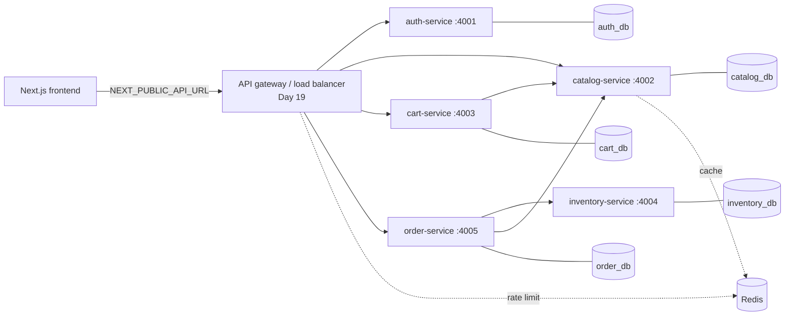

# Service boundaries and diagram

Plan: `microservices_marketplace_30_day_plan_multi_server`. Small service count, each owning its data and exposing a documented API.

| Service | Port | Owns | Day built |
|---|---|---|---|
| auth-service | 4001 | users, refresh tokens, roles | 4 ✅ |
| catalog-service | 4002 | categories, products, seller profiles, images | 6-9 |
| cart-service | 4003 | carts, cart items | 10 |
| inventory-service | 4004 | stock, reservations (DB is the source of truth) | 12 |
| order-service | 4005 | parent orders, seller orders, payment/COD state, outbox | 13-16 |

Payment/COD lives inside order-service; notification worker and admin module come later (Day 16, 20).

## Rules
- Frontend only knows the gateway/base API URL, never internal service URLs.
- No shared tables; services talk over HTTP APIs (with timeouts, bounded retries, idempotency keys, `x-request-id` correlation).
- Services are stateless: sessions/tokens in DB or JWT, shared cache and rate limits in Redis, no local files.
- Money = integer minor units (poisha). Ids = UUID.
- Checkout recalculates prices server-side, uses idempotency keys, reserves stock atomically.

## Conventions
- Base path `/api/v1` per service; each exposes `GET /health` (liveness) and `GET /ready` (dependencies).
- Success: `{ "data": ... }`; list: `{ "data": [...], "meta": { page, limit, total } }`.
- Error: `{ "error": { "code", "message", "details": [] } }` with 400/401/403/404/409/422/429.
- Auth: `Authorization: Bearer <accessToken>` (15 min JWT, claims `sub`, `role`); refresh token in httpOnly cookie, rotated on use.
